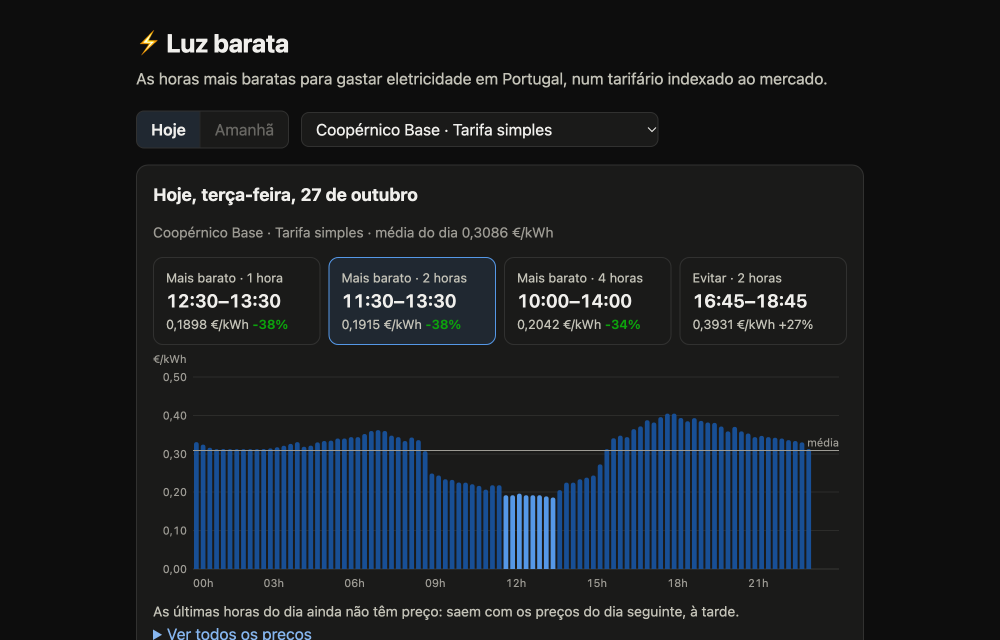
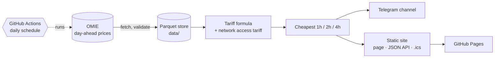

# luzbarata ⚡

[](https://github.com/nmmsousa/luzbarata/actions/workflows/ci.yml)
[](https://github.com/nmmsousa/luzbarata/actions/workflows/daily.yml)

[](LICENSE)

Tells people in Portugal the cheapest hours to use electricity tomorrow, based on the
OMIE day-ahead market prices that are published every afternoon.

**Live:** [nmmsousa.github.io/luzbarata](https://nmmsousa.github.io/luzbarata/) ·
**Telegram:** [t.me/luz_barata](https://t.me/luz_barata) ·
**API:** [`api/v1/index.json`](https://nmmsousa.github.io/luzbarata/api/v1/index.json)

[](https://nmmsousa.github.io/luzbarata/)

## Highlights

- **Runs itself, at no cost.** GitHub Actions fetches prices every afternoon, posts to Telegram,
  commits the data and redeploys the static site on GitHub Pages. There is no server.
- **Handles awkward time data.** Market days are in Madrid time, the page is in Lisbon time,
  days have 92, 96 or 100 quarter-hours around daylight saving, and the files switched from
  hourly to 15-minute periods in October 2025. Tests use real OMIE files for every case.
- **Prices checked against a primary source.** Every tariff constant in
  [`tariffs.toml`](src/luzbarata/tariffs.toml) records its source and the date it was checked.
  The Coopérnico formula reproduces the provider's own price table to 4 decimal places.
- **Safe to rerun.** Fetching skips stored days, saving replaces a whole day atomically, and the
  Telegram post is logged so a retried run never posts twice.
- **Public data products.** A versioned JSON API and `.ics` calendar feeds alongside the page,
  built with vanilla JS and an inline SVG chart (no external scripts).

## How it fits together



Python 3.12 · httpx · Polars · Parquet · pytest · ruff · uv · GitHub Actions · GitHub Pages

## Example

```text
$ luzbarata windows --date 2026-10-26 --option tri --cycle weekly
Coopérnico Base · tri-hourly, weekly cycle · Mon 26 Oct 2026 (Lisbon time)
EUR/kWh without VAT · 92/96 slots known

Day average                      0.3130
Cheapest 1h         13:00-14:00  0.1166  (-63%)
Cheapest 2h         12:00-14:00  0.1172  (-63%)
Cheapest 4h         12:00-16:00  0.1507  (-52%)
Most expensive 2h   18:30-20:30  0.6004
```

## How the data works

OMIE (the Iberian electricity market operator) publishes a file per delivery day with the
marginal price for Portugal (`marginalpdbcpt_YYYYMMDD.1`). A few things make it less simple
than it looks, and the ingestion handles all of them:

| Quirk | How it is handled |
|---|---|
| Delivery days and period numbers are in **Spanish time** (Europe/Madrid), so period 1 starts at 23:00 Lisbon time the previous day | Periods are stored with exact `start_utc`/`end_utc`; display converts to Europe/Lisbon |
| **Hourly** periods until 2025-09-30, **15-minute** periods from 2025-10-01 | Resolution is derived from the length of the day and the row count, then validated |
| **Daylight saving** days are 23h or 25h long (23/25 or 92/100 periods) | Day length comes from Madrid timezone rules; any other count is rejected |
| Days not yet published return a **404** (or sometimes an HTML page with HTTP 200) | Detected and reported as "not available" (exit code 2) without retrying, separate from real failures |
| Network hiccups | Retries with backoff on HTTP errors |

Validation also rejects rows for another day, duplicate or missing periods, and prices
outside the harmonised market limits (-500 to 4000 EUR/MWh).

## Storage

Parquet, one file per month, rewritten atomically:

```
data/prices/year=2026/2026-10.parquet
```

| column | type | notes |
|---|---|---|
| delivery_date | date | market day (Madrid) |
| period | int16 | 1..n |
| resolution_minutes | int16 | 60 or 15 |
| start_utc / end_utc | timestamp UTC | exact period bounds |
| price_eur_mwh | float64 | Portuguese marginal price |
| ingested_at_utc | timestamp UTC | when it was downloaded |

Saving a day replaces any rows already stored for it, so every command is safe to re-run.
Query it with DuckDB: `select * from 'data/prices/*/*.parquet'`.

## From market price to what the customer pays

```
final price (EUR/kWh, no VAT) = provider energy price + network access tariff (TAR)
energy = (max(OMIE, floor) × factor + k_before_losses) × (1 + losses) + k_after_losses
```

Everything that changes over time lives in [`tariffs.toml`](src/luzbarata/tariffs.toml), with
its source and the date it was checked:

| Data | Source | Changes |
|---|---|---|
| TAR 2026, BTN ≤ 20.7 kVA | ERSE, as published by EDP | every January |
| Coopérnico Base | provider price table (July 2026); the formula reproduces it to 4 decimals (tested) | when the provider changes it |
| G9 Smart Index | provider FAQ | when the provider changes it |

The TAR depends on the tariff **option** (simple, bi-hourly, tri-hourly) and the metering
**cycle** (daily, or weekly with different weekday/Saturday/Sunday hours). Both cycles have
separate winter and summer schedules, in [`tariffs.py`](src/luzbarata/tariffs.py).

A Lisbon calendar day spans two OMIE delivery days (23:00–24:00 comes from the next one), so
tomorrow's last hour is unknown until the day after is published. Windows never span missing slots.

**Known simplifications** (all affect the price level more than which hours are cheapest):
- Losses are the providers' indicative constant (15–16%), not ERSE's 15-minute loss profile.
- Prices exclude VAT and other taxes and fees.
- Only BTN up to 20.7 kVA. TAR is configured for 2026 only; other years raise an error.
- ERSE has approved new time schedules, applied to each BTN customer on a date between
  2027-07-01 and 2027-12-31. They must be added before then.

## Usage

Requires [uv](https://docs.astral.sh/uv/).

```bash
uv sync

uv run luzbarata fetch                      # tomorrow (exit 2 if not published yet; skips stored days, --force re-downloads)
uv run luzbarata fetch --date 2026-10-26
uv run luzbarata backfill 2024-01-01 2026-10-26   # skips days already stored, 1s between requests
uv run luzbarata show --date 2026-10-26     # prices in Lisbon time

# cheapest 1h/2h/4h on a Lisbon day (default: tomorrow)
uv run luzbarata windows --provider g9-smart-index --option bi --cycle daily

# tomorrow's Telegram message (Portuguese); without --dry-run it posts, once per day
uv run luzbarata post --dry-run

# web page, JSON API and calendar feeds for the last 30 days, into ./site
uv run luzbarata site
python -m http.server -d site     # then open http://localhost:8000
```

The store location defaults to `./data`; override with `--data-dir` or `LUZBARATA_DATA_DIR`.

## Daily automation

[`.github/workflows/daily.yml`](.github/workflows/daily.yml) runs five times each afternoon
(UTC). Each run:

1. `luzbarata fetch` gets tomorrow's prices. Exit 2 (not published yet) is fine, except on the
   19:15 UTC attempt, where it fails the run so GitHub emails the owner.
2. `luzbarata post` sends the message to the channel: Coopérnico Base, simple and bi-hourly
   (daily cycle) tariffs. Days already posted are listed in `data/telegram_posts.csv`, so a
   rerun never posts twice.
3. Anything new under `data/` is committed to the repo.
4. If that pushed a commit, [`pages.yml`](.github/workflows/pages.yml) rebuilds the site and
   deploys it to GitHub Pages. Code pushes to `main` also redeploy it.

Repo secrets: `TELEGRAM_BOT_TOKEN` (from @BotFather) and `TELEGRAM_CHAT_ID` (e.g.
`@channelname`; the bot must be an admin of the channel).

## Web page and API

`luzbarata site` writes a static site that GitHub Pages serves as is. The page is in Portuguese,
works without any external scripts, and picks today or tomorrow in the browser (Lisbon time), so
it only needs rebuilding when new prices arrive.

| Path | Content |
|---|---|
| `index.html` | chart of the day in 15-minute slots, cheapest 1h/2h/4h, the 2h to avoid, a tariff picker |
| `api/v1/index.json` | tariffs (id, option, cycle, formula source) and the days available |
| `api/v1/days/YYYY-MM-DD.json` | one Lisbon day: slots in UTC with the OMIE price, and per tariff the final price and period of every slot, the day average and the windows |
| `calendar/<tariff>.ics` | one event per day at the cheapest 2h; UIDs are stable, so events update in place |

Only tariffs whose formula has been checked against the provider's own prices are published
(Coopérnico Base for now, every option and cycle). Prices are EUR/kWh without VAT.

## Development

```bash
uv run pytest
uv run ruff check . && uv run ruff format --check .
```

Tests run against real OMIE files saved in `tests/fixtures/`, covering every combination of
hourly / 15-minute and normal / spring-forward / fall-back days.

## Project history

Built in four phases, each live before the next started:

1. ✅ Ingestion: fetch, validate, store, backfill
2. ✅ Cheapest windows (1h / 2h / 4h) and final price for indexed-tariff providers
3. ✅ GitHub Actions daily schedule + Telegram channel message
4. ✅ Web page with chart, JSON API and `.ics` calendar feed

The repo gets one data commit a day from the `daily` workflow; that is the automation at work.

**Future work:** personalisation (provider, tariff schedule), alerts and a savings calculator.

## License

Code under the [MIT License](LICENSE). Market data © OMIE; this project is independent and not
affiliated with OMIE or any electricity provider. Prices shown are estimates for information only.
